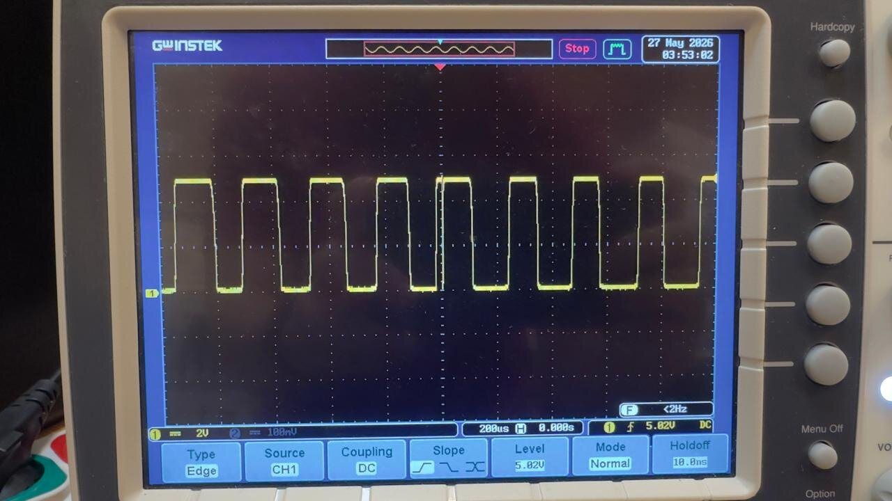
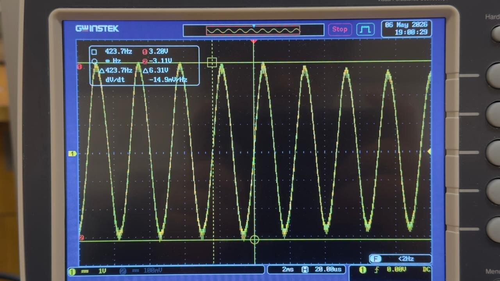
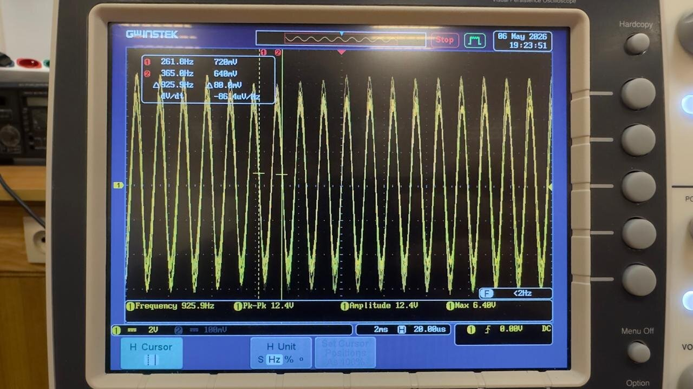
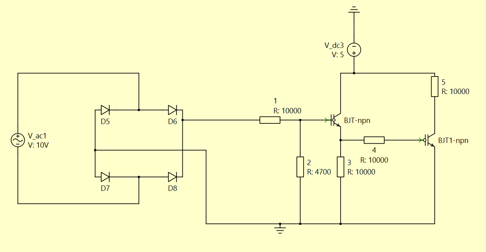
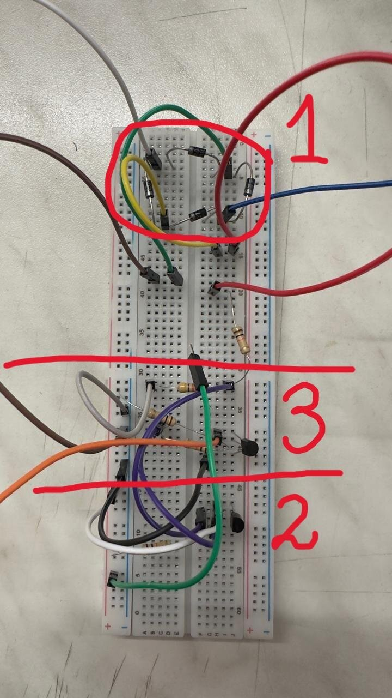
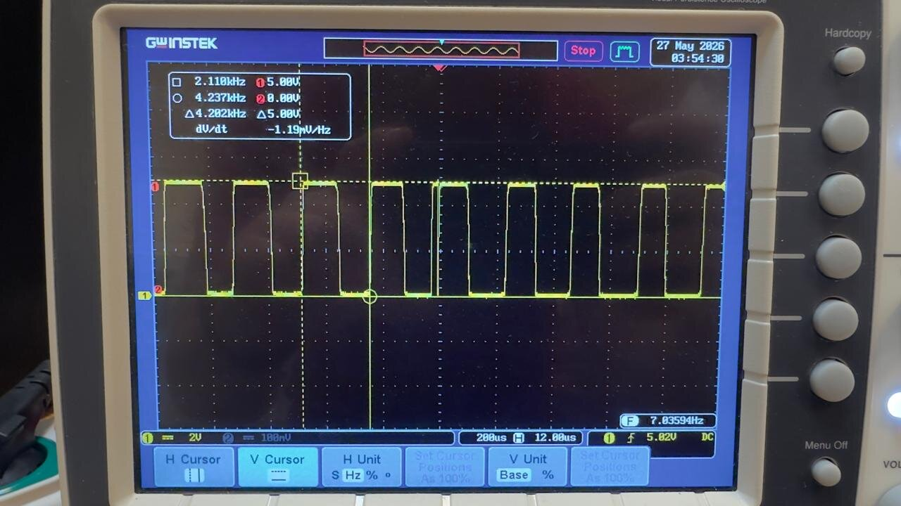
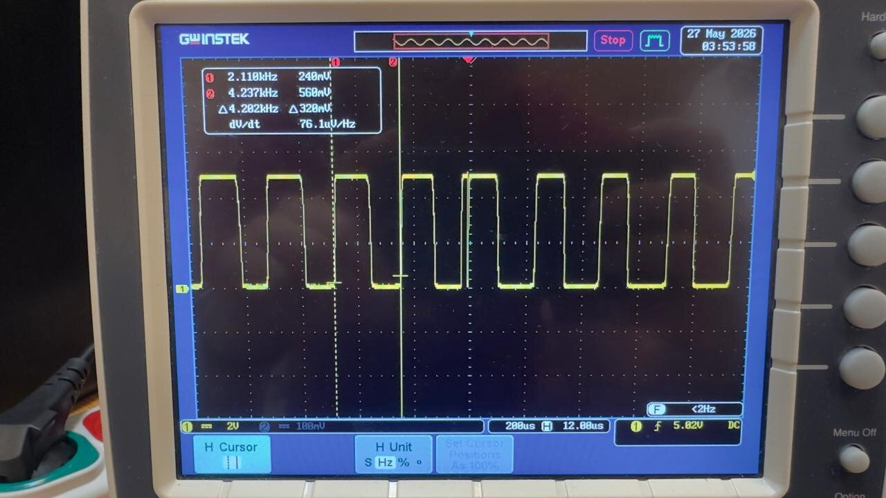
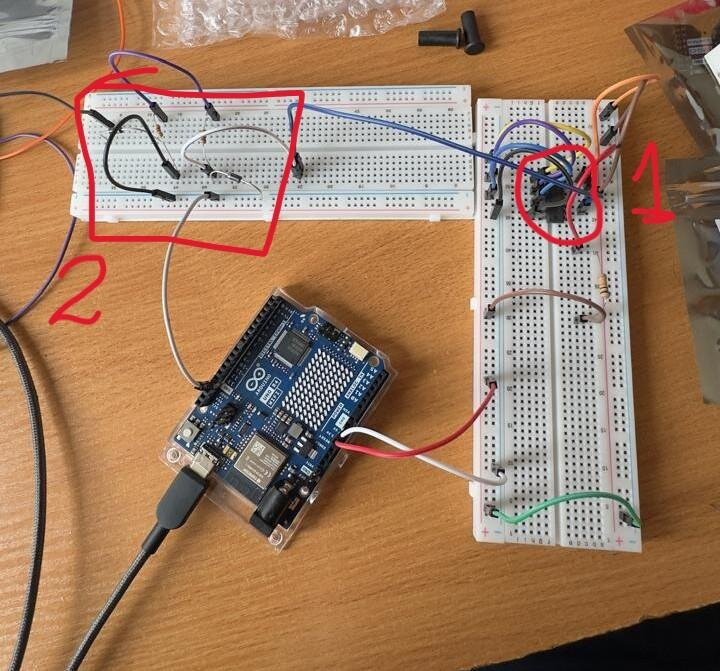
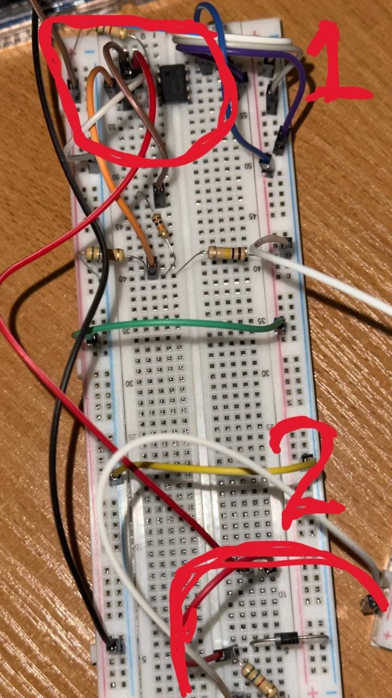

# Signal Conditioning Circuit for an Inductive Speed Sensor (RPM Meter)

Discrete analog circuit that turns the noisy, variable-amplitude sine wave from an inductive speed sensor (**6–24 V pk-pk**, centered at 0 V) into a clean **0–5 V square wave** that can go straight into a microcontroller input. Built and tested on a breadboard with real sensor signals.

Course project for *Automotive Electrical Systems*, Warsaw University of Technology, 2026.

## The problem

An inductive speed sensor outputs an AC sine wave. Its amplitude and frequency both grow with rotational speed:

| Low speed: 6 V pk-pk | High speed: 24 V pk-pk |
|---|---|
|  |  |

A microcontroller pin accepts only 0–5 V, so the signal has to be rectified, limited and squared up. The output also has to stay stable across the whole 4:1 amplitude range.

## Final circuit

Signal path: **Full-wave diode bridge → Resistive divider → Common-collector stage → Common-emitter stage**

1. **Full-wave diode bridge (D5–D8, 1N4007).** Rectifies both half-cycles of the AC input into positive pulses.
2. **Resistive divider (R1 10 kΩ, R2 4.7 kΩ).** Scales the rectified signal down and sets the base drive of the first transistor.
3. **Common-collector stage (BC547C, emitter follower).** Buffers the signal with a low-impedance drive into the next stage.
4. **Common-emitter stage (BC547C, R5 10 kΩ collector load to 5 V).** Works as a saturating switch, so the output at the collector is a clean 0 V / 5 V square wave.

| Component | Qty |
|---|---|
| 1N4007 diode (1 A / 1000 V) | 4 |
| BC547C NPN BJT | 2 |
| Resistors (10 kΩ, 4.7 kΩ) | 5 |
| 5 V DC supply | 1 |

*Breadboard implementation: (1) diode bridge, (2) common-collector stage, (3) common-emitter stage.*

## Results

| Output amplitude: 0–5 V | Output frequency |
|---|---|
|  |  |

- The output was a stable **0–5 V square wave** at both the minimum (6 V pk-pk) and maximum (24 V pk-pk) sensor amplitudes.
- **Output frequency = 2 × input frequency**, because the full-wave bridge turns both half-cycles into pulses (for example, 4.2 kHz measured at the output for a 2.1 kHz input). To get RPM, divide the pulse frequency by 2.
- The output can be fed directly into a microcontroller timer or interrupt pin.

## Approaches that failed (and why)

| Approach | IC | Why it failed |
|---|---|---|
| Schmitt trigger | SN74HC14N | Its input is limited to the 5 V supply rail, and the sensor peaks went well above that. |
| Comparator with hysteresis | LM393P + Zener clamp | I couldn't get reliable thresholds across the full 6–24 V range, and the output stayed unstable. |

| Schmitt trigger attempt | Comparator attempt |
|---|---|
|  |  |

**Lesson:** the IC solutions needed much more protection and biasing circuitry than expected. A discrete two-transistor design turned out simpler and more robust.

## Possible extensions

- Add a frequency-to-voltage converter so a microcontroller ADC can read RPM directly.
- Move to a PCB for better noise immunity than the breadboard.

## Files

| File | Content |
|---|---|
| [`Signal_Conditioning_Report.pdf`](Signal_Conditioning_Report.pdf) | Full project report |
| [`Presentation.pdf`](Presentation.pdf) | Project presentation slides |
| `*.jpg`, `schematic.png` | Figures used in this README |

## Tools and skills

Analog circuit design · BJT biasing · Diode rectification · Breadboard prototyping · Oscilloscope measurement · Datasheet analysis

## References

1. [SN74HC14 datasheet](https://www.ti.com/lit/ds/symlink/sn74hc14.pdf), Texas Instruments
2. [LM393 datasheet](https://www.ti.com/lit/ds/symlink/lm393.pdf), Texas Instruments
3. B. Razavi, *Fundamentals of Microelectronics*
4. [Comparator with hysteresis reference design (TIDU020A)](https://www.ti.com/lit/ug/tidu020a/tidu020a.pdf), Texas Instruments

## Author

**Nurmukhammed Polat**, Electrical Engineering, Warsaw University of Technology
[LinkedIn](https://www.linkedin.com/in/nurmukhammed-polat-6a6677251/)
